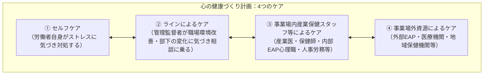
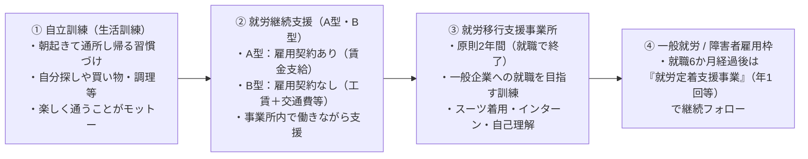
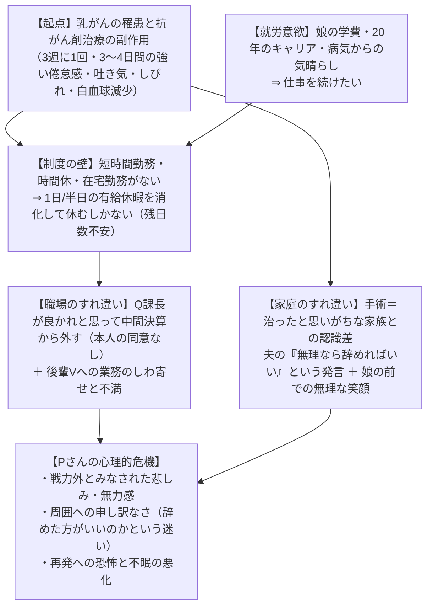
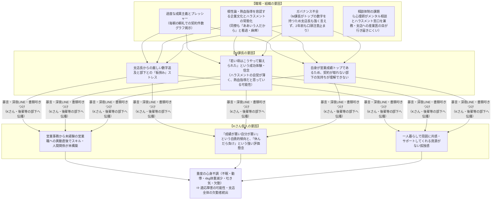

# 産業心理学特論 講義まとめ（2026年11月2日・11月4日）

> **対象講義ノート**
> - [20261102.md](file:///C:/Users/Cyril/univ/01_coursework/m1_2/special_lectures_on_industrial_psychology/20261102.md)（2026年11月2日 講義）
> - [20261104.md](file:///C:/Users/Cyril/univ/01_coursework/m1_2/special_lectures_on_industrial_psychology/20261104.md)（2026年11月4日 講義）

---

## 目次

1. [産業保健活動と心理職の役割・活躍の場](#1-産業保健活動と心理職の役割活躍の場)
2. [EAP（従業員支援プログラム）とメンタルヘルスケア体制](#2-eap従業員支援プログラムとメンタルヘルスケア体制)
3. [組織と人的資源管理（HRM）・健康経営](#3-組織と人的資源管理hrm健康経営)
4. [労働問題と労働関係法規・安全衛生管理体制](#4-労働問題と労働関係法規安全衛生管理体制)
5. [多様な就労支援と両立支援（がん・メンタル不調・障害・育児介護・パワハラ）](#5-多様な就労支援と両立支援がんメンタル不調障害育児介護パワハラ)
6. [事例検討I：がん治療と就労の両立支援（Pさんの事例）](#6-事例検討iがん治療と就労の両立支援pさんの事例)
7. [事例検討II：職場におけるハラスメントとメンタルヘルス不調（Kさんの事例）](#7-事例検討ii職場におけるハラスメントとメンタルヘルス不調kさんの事例)
8. [産業領域における心理職のキャリアと研鑽](#8-産業領域における心理職のキャリアと研鑽)

---

## 1. 産業保健活動と心理職の役割・活躍の場

### 1.1 産業保健活動の基本理念
* **目的**：労働条件や労働環境に関連する**健康障害の予防**、および**労働者の健康の保持増進**（単に疾病を防ぐだけでなく、健康を維持・増進し、福祉の向上に寄与する）。
* **対象の範囲**：労働者個人のみならず、労働者が所属する**組織や地域**も対象となる。
* **特徴**：
  * 個人のカウンセリングや心理検査（従来の心理職のイメージ）にとどまらず、組織や地域にも働きかけるため、**多職種連携の幅が非常に広い**。
  * **疾病に対する直接的な治療は行わない**（治療は外部の医療機関・主治医の役割であり、産業医にも主治医の意見に従う義務がある）。
  * 公認心理師の五領域（医療・福祉・教育・司法・産業）は明確に切り分けられるものではなく、相互に重複・関連しているため、事例を通してイメージを掴むことが重要。

### 1.2 産業・関連領域における心理職の活躍の場（グループディスカッション＆講義解説）

| 活躍の場・機関 | 主な対象・役割・特徴 |
| :--- | :--- |
| **企業内（内部EAP・健康管理センター）** | ・大企業を中心に自前の健康管理センターや内部EAPを持ち、心理職を正規雇用・非常勤雇用する場合がある。 ・産業医、保健師・看護師、産業カウンセラー等と連携。 ・ストレスチェックの実施・フォロー、面談、復職支援など。内情を把握しているため相談しやすいメリットがある。 |
| **外部EAP機関・労働研究所** | ・自前で相談窓口を持つことが難しい企業（または内部と併用する企業）と委託契約を結び、カウンセリングや研修、ストレスチェック分析を提供。 ・労働組合が会社と交渉するための従業員調査・労働環境調査を代行することもある（大学や労働研究所など）。 |
| **医療機関のリワーク（復職支援）** | ・病院内に教室を設け、復職支援（リワーク）を行う医療機関がある（就職活動の際も、産業領域に力を入れている病院かどうかに注目するとよい）。 ・毎日通う形式だけでなく、診察のついでにストレスマネジメント講座やアサーショントレーニング（例：全5回シリーズで問題解決スキルを身につける等）を主治医の勧めで実施する形態もある。 |
| **就労系障害福祉サービス** （自立訓練・就労移行・就労継続A/B・定着支援） | ・作業所や事業所での傾聴、人間関係の悩み相談、SST（社会生活技能訓練）、職能評価など。 ・福祉と産業が重複する領域（詳細は[第5章 5.3](#53-障害者雇用と就労支援発達障害精神障害など)を参照）。 |
| **公的機関・行政・その他** | ・**障害者職業センター**：障害者職業カウンセラー（ジョブカウンセラー）として職能評価（簿記・経理作業等の評価）、就労先とのマッチング、就労後の定期面談、精神的不調による休職者の復職支援、企業側へのアプローチを行う。 ・**ハローワーク**：就職支援・相談にあたる心理職が配置されている。 ・**産業保健総合支援センター**（労働者健康安全機構：JOHAS）：心理職の募集あり。 ・**行政・警察**：大阪府などでは行政や警察の心理職枠が増えている。 |
| **大学のキャリアセンター** | ・健常学生だけでなく、配慮が必要な学生のキャリア支援（出口支援・合理的配慮）も重要。 ・大学に通いながら福祉の就労移行支援事業所に通っている学生や、就労移行の支援者が大学に入り込んで連携するケースもある。 ・産業領域の心理職には国家資格「**キャリアコンサルタント**」を取得する人もいる。 |

### 1.3 本岡先生の専門と研究・実践の背景
* **専門領域**：**問題解決療法（Problem-Solving Therapy: PST）**
  * うつ病患者の問題解決プロセスを調査し、問題解決モデルに基づいて「うつや不安の状態にあるときの問題解決プロセスが、そうでないときとどう異なるのか」を研究。
  * 「何が効いて、何が良くなるのか」を検証するプログラムを作成（もともと医療領域で研究・臨床を行い、産学共同事業へ展開）。
* **ストレスチェックと未然予防**：
  * ストレスチェックは「**未然予防（一次予防）**」の位置づけ。高ストレス者でなくても、現在のストレス（例：睡眠の問題など）に対する適応的なストレス対処（コーピング）を身につけるために活用される。
* **がん患者への問題解決療法と保険点数化**：
  * がん患者のリエゾン（精神腫瘍学領域）で働く心理士の活動において、がん患者の心理面接が**6回まで保険点数の対象（がん患者指導管理料）**となった。
  * 6回という限られた枠組みの中で、がん患者の問題をどう整理するかは難しいため、問題解決療法をベースにした支援プログラムを開発・研究した。
  * **エビデンスの重要性**：厚生労働省が保険点数の対象とするには、「何をどう実施したら効果があるのか」という研究データの蓄積（認知行動療法などと同様の効果保証）が不可欠。保険点数化されたことで実施しやすくなった反面、「どのような介入を行い、どのような効果があったのか」を明確に示す責任が求められる（がん患者の心理的苦痛緩和に向けた問題解決療法マニュアルも公開されている）。

---

## 2. EAP（従業員支援プログラム）とメンタルヘルスケア体制

### 2.1 内部EAPと外部EAPの特徴・連携
* **内部EAP**：
  * 社内の制度や人間関係、職場の内情をよく知っていることが最大のメリット。もちろん相談内容は守秘される。
* **外部EAP**：
  * 従業員にとって会社から独立した形態で安心して相談できる窓口。
  * 外部EAPの心理職は社内の細かい制度が分からないため、クライエント本人から直接聞いたり、**クライエントの許可を得て人事課などに確認**したりする（相談内容が許可なく内部に漏れることは絶対にない）。
  * **代表的な外部EAP・関連機関の例**：
    * [一般社団法人 日本産業カウンセラー協会 / 労働研究所等](https://www.iewri.or.jp/about/our-movement.html)
    * [MBK Wellness株式会社](https://www.mwk.co.jp/business)：人材育成・紹介やEAP事業を展開。日本産業ストレス学会などではこうしたEAP所属の心理職の発表が多い。
    * [株式会社ワークウェイ（WorkWay）](https://www.workway.co.jp/consultation/eap/about/)：海外事業所との契約が多く、海外赴任者も視野に入れて設立された新しい会社。
    * [株式会社フィスメック](https://www.fismec.co.jp)：専門職を多く雇用しており、従業員の4人に1人が公認心理師・臨床心理士。
* **個人の心理師とEAP・産業医・主治医の連携事例**：
  * EAPに直接就職しなくても、働くクライエントと関わると連携先としてEAPが登場する。
  * **事例**：本岡先生の個人クライエントが休職際、産業医から「外部EAPの復職支援プログラムに行くように」と指示された。EAPと主治医が連携して復職を目指す中、個人の心理師（本岡先生）はクライエントの状況を整理し、「産業医との面談で何をどう話すか」「復職支援の進捗を踏まえて会社に何を報告するか」を一緒に整理する役割を担った。
  * なお、復職支援は「元の職場に戻ること」が前提だが、結果として復職しない判断に至ることもあり、その場合は就労移行支援事業所やハローワークへ繋げることもある。

### 2.2 労働者の心の健康の保持増進のための指針（「4つのケア」）
厚生労働省の指針に基づき、事業所は以下の「4つのケア」を継続的かつ計画的に実施する（「心の健康づくり計画」）。

* **セルフケア**：
  * 全従業員向け（管理職自身のセルフケアも含む。「今、大変なことはないですか？」といったワークショップ形式など）。
  * 研修テーマとしては**ストレスマネジメント**や**アサーション**が多い（動画配信形式で実施されることもある）。
  * 精神疾患の前兆となる状態、相談先、対処方法などを学ぶ。
* **ラインによるケア（ライン＝管理監督者）**：
  * 専門家が気づくよりも、日常的にそばにいる管理職が早く気づけるよう、ケアの知識やスキルを身につけてもらう（「現状が緩和される相談先は管理職である」というデータもある）。
  * **部下の不調に早めに気づくためのサイン（症状が出る前・病気になってからでは遅い）**：
    * いつも明るい人の声のトーンが下がっている
    * 口数の変化（急に減る・増える）
    * 食欲がなさそう（例：普段は昼食に誘うと来るのに、来なくなった等。非常によくあるサイン）
    * 表情の変化
    * 勤怠の乱れ（遅刻や欠勤が増える）
  * **気づいた後の対応**：まずは**声をかけ、話を聞く**。あわせて**職場環境を整える**。
  * **管理職自身の孤立課題**：労働安全衛生調査（令和8年7月最新等）によると、従業員規模が大きい会社ほどメンタルヘルス対策（研修等）を行っているが、管理職自身のサポート源はポジションが上に行くほど少なくなり、支援を得にくい構造がある（中間管理職のストレス研究も重要なテーマ）。

### 2.3 EAPとフォローアップに関する質疑応答（Q&A）

> [!NOTE]
> **【Q】内部EAP（健康管理センター等）を持つ会社でも、外部EAPと委託契約を結ぶことはあるのか？**
> **【A】YES（結ぶことがある）。**
> 法律の指針にある「4つのケア」のうち「④事業場外資源によるケア」に該当する。社内ではどうしても相談しにくい内容もあるため、外のEAPと契約したり、外部の復職支援プログラムを利用したり、小規模事業場であれば外部相談機関のリストを載せた冊子を配布して紹介にとどめたりと、外部へのパイプを持っている（冊子の中に内部EAPと外部機関の両方が記載されていることもある）。

> [!NOTE]
> **【Q】EAP企業が多い中で、事業者はどのようにEAPを選択しているのか？**
> **【A】明確な仕組みはなく、信頼できる人からの紹介や営業、価格帯で選ばれているのが実情。**
> * EAP企業の営業担当が回っており、料金体系も多様（助成金制度もある）。
> * **社会保険労務士（社労士）の役割**：社労士は雇用契約書の作成等で普段から社長と話す機会が多い。そのため社長から「従業員がメンタル不調でどうしたらいいか、話を聞いてくれないか」と相談され、社労士が従業員の話を聞いたり、社労士から大学の心理職（本岡先生）へ相談が持ち込まれたりすることがある。
> * 事業所はどこに頼めばいいか分からず信頼できる人に相談することがほとんどで、導入しても形骸化しているケースもある。しかし、労働力不足（売り手市場）の現在、労働者の声を聞いて職場環境や福利厚生を改善し、長く働いてもらうこと（人的資本への投資）がますます重要になっている。

> [!NOTE]
> **【Q】ストレスチェック後のフォローアップ面談などは、企業側が「聞いてほしいこと」を依頼するのか、それともクライエント本人の希望ベースか？**
> **【A】ケースによって「本人希望（自由相談）」と「会社からの依頼（枠組みあり）」の両方がある。**
> 1. **ストレスチェック後の面談**：会社側から「高ストレスなので相談を推奨します」とフィードバックが行き、本人が「行ってみたい」と希望して来談する場合は、**相談内容は自由**であり、「結果を受けて本人がどうしたいか」を知る目的で行う。
> 2. **ハラスメント行為者へのカウンセリング依頼**：会社がハラスメント認定をした際、**行為者側に5回限定でカウンセリング（フォロー・教育）**を依頼されることがある。行為者側も強いストレスがかかっていることが多いため。
> 3. **復職後のフォローアップ面談**：専門家が常駐していない企業から「復職後の困りごとを5回限定で聞いてフォローしてほしい」と依頼されることがある。ただし会社主導の依頼であるため、**復職者本人のモチベーションが低い（本人のニーズと会社の要望が合っていない）**こともある。

> [!NOTE]
> **【Q】職種や業種に合わせて研修内容を変えるか？また、心理職側から企業へ研修を働きかける（営業する）ことはあるか？**
> **【A】問題解決・アサーションの枠組みで現場の困りごとを引き出す。また、EAPはストレスチェック等を入り口に営業を行っている。**
> * **異業種への研修方法**：心理職側もすべての業種の実情を把握しているわけではなく、急に未知の業種から呼ばれることもある。そのため、基本的には**セルフワークやグループワークで「仕事の中で今困っていること」をその場で出してもらい**、問題解決療法の観点から「どういう人間関係が築ければいいか（目標設定）」「そのために明日からできることは何か」「どう伝えられるか（アサーション）」というコミュニケーションのスタンスを扱う。なお、特定の個人を標的（棚上げ）にした発言が出た場合は、その個人には触れず、一般的な対策としてできることを伝える。
> * **研修の導入経路**：研修は義務化されていないため費用がネックになるが、外部EAPは「ストレスチェックを無料で実施・分析し、その結果をもとに『おすすめの研修』を提案・営業する」という手法をとることがある。そこから繋がりができ、継続的に研修が導入されることがある。

---

## 3. 組織と人的資源管理（HRM）・健康経営

### 3.1 オープンシステム・アプローチと人的資源管理（HRM）
* **オープンシステム・アプローチ**：
  * 組織を「外部環境と相互作用する開かれたシステム」として捉える考え方。組織は外部から**入力（資源・人材等）**を受け取り、それを内部で**処理（変換）**して、外部へ**出力（製品やサービス）**を生み出す。
  * 少子高齢化や労働人口の変化に伴い、個人のみならず組織の様相も加味して、個人の適性に合った仕事を提供することが求められる。
* **人的資源の管理（HRM：人事部門の業務）**：
  1. **雇用管理**：日本企業は伝統的に「新卒一括採用し、組織の中で育成し、組織に適合してもらう（メンバーシップ型）」価値観のもとで採用してきた（コロナ禍で欧米式のジョブ型にしようとした動きもあったが、結局は個人と組織の適合を重視する形に戻りつつある）。※ただし**心理職は例外**で、現場に出ないと求められるスキルが異なる。
  2. **キャリア開発**：企業だけでなく大学もその役割を求められている。
  3. **人事考課**：職員への評価。「組織の課題達成へどの程度貢献したか」を評価し、ボーナスや昇進に反映させる制度（心理職や大学教員も評価対象となる）。きちんと働いている人を正当に評価し、モチベーションにつなげる。
  4. **報酬の管理**：労働者の作業成果に対してどのような対価を支払うか。
  5. **福利厚生制度**：上記すべてが労働者のやる気（ワーク・モチベーション）に直結する。

### 3.2 健康経営と現代の産業・組織課題
* **健康経営**（経済産業省が推進）：
  * 従業員の健康管理を経営的な視点で考え、戦略的に実践すること（[経産省資料：健康経営の推進について](https://www.meti.go.jp/policy/mono_info_service/healthcare/downloadfiles/251017_kenkoukeieigaiyou_.pdf)）。
  * **生涯現役社会の実現**：年齢を重ねても働き続けられる環境づくりが政策課題となっている。
  * **主な取り組み**：予防的健康管理、定期健診の充実、生活習慣病予防プログラム、メンタルヘルス対策など。
    * *ユニークな実践例*：社内コミュニケーションが少ないと精神衛生上良くないため、「2人で同時に社員証をかざすと無料で飲み物が買える自動販売機」を導入し、自然な会話を促した企業の例がある。
* **近年の産業・組織領域の課題**：
  1. **国内消費の減少とDX・多様性採用**：ITやAI教育を受けていない社員への社内教育の促進。また、「対人関係は苦手だがプログラミングが得意な人」を採用するなど、強みを活かした配置。
  2. **キャリアデザインからライフデザイン（ワーク・ライフ・バランス）へ**：子育て・介護・病気治療と仕事の両立支援。
  3. **テレワーク労働の課題**：国はテレワークを推奨しており、情報通信系企業では定着しているが、運輸業や現場事務系など業界によっては導入・定着が困難な実態がある（[厚労省資料](https://www.mhlw.go.jp/content/11911500/001683114.pdf)）。

---

## 4. 労働問題と労働関係法規・安全衛生管理体制

働く実情の変化に伴って法律も変化している。カウンセリング場面でクライエントに「労働契約（雇用契約）や就業規則はどうなっている？」と聞いても「何それ…」と把握していない労働者が非常に多いため、心理職自身が法規と契約の基本を理解しておく必要がある。

### 4.1 労働関係調整法（労働争議の調整手法）
雇用主と労働者の主張が噛み合わず争いが生じた際、労働委員会（組合員、弁護士、大学教員、会社役員などで構成）が仲介する3つの手法。

| 調整方法 | 強制力・拘束力 | 特徴・内容 |
| :--- | :--- | :--- |
| **① 斡旋（あっせん）** | **なし**（合意は任意） | ・最も簡易な調整方法。 ・斡旋員が当事者間の話し合いを促進し、両者の合意を尊重するのみ。 |
| **② 調停（ちょうてい）** | **なし**（受諾は任意） | ・斡旋よりも一歩踏み込んだ調整方法。 ・調停委員会が「調停案」を作成し、当事者に**受諾を勧告**する。 |
| **③ 仲裁（ちゅうさい）** | **あり（法的拘束力）** | ・最も強力な調整方法。 ・仲裁委員会が下す「仲裁裁定」には法的拘束力があり、当事者は従う義務がある。 |

* ※医療分野などは労働組合がしっかり組織されている（昔は看護師の給与が低かった背景などから発展した）。近年は労働組合を持たない会社もあるが、組合があることで会社側も制度を整え、労働者の働きやすさに繋がる。経営者側も労働組合の意見を「ありがたい」と聞く人が増えている。

### 4.2 法規範の優先順位（強行法規）と雇用契約・安全配慮義務
* **法的効力の優先順位（強い順）**：
  $$\text{労働法等の強行法規} > \text{労働協約（組合との協定）} > \text{就業規則} > \text{労働契約（民法上の「雇用契約」）}$$
  * 口約束（「あの時こう言ったじゃないか」）には効力が全くないため、必ず**労働契約書と就業規則を確認・記録する**ことが重要。
* **安全配慮義務（労働契約法 第5条）**：
  * 「使用者は、労働契約に伴い、労働者がその生命、身体等の安全を確保しつつ労働することができるよう、必要な配慮をするものとする」
  * 果たされない場合は、使用者に**損害賠償責任**が課せられる（かつての栄養ドリンクCM「24時間働けますか」のような働き方は現在では明確に違法・労災対象だが、依然として労災認定件数はなかなか減らない実情がある）。

### 4.3 労働安全衛生法と管理体制
職場の安全と健康を守り、労働災害を防止することを目的とする法律。事業場の規模（常時使用する労働者数）に応じて選任義務が定められている。

| 事業場規模（常時使用する労働者数） | 選任が必要な役職・体制 | 備考 |
| :--- | :--- | :--- |
| **50人以上** | ・**総括安全衛生管理者**（業種・規模による） ・**安全管理者** / **衛生管理者**（安全・衛生の技術的事項を管理） ・**産業医** ・**安全衛生委員会**（または衛生委員会）の設置 | 総務や人事の担当者が兼任することがほとんど。そのための研修を外部EAPが請け負うこともある。 |
| **10人以上 ～ 50人未満** | ・**安全衛生推進者** または **衛生推進者** | 安全衛生に係る業務担当が必要。 |

### 4.4 男女雇用機会均等法（ポジティブ・アクション、間接差別、例外と記録の重要性）
勤労婦人福祉法から発展して制定された法律。マタハラ・セクハラ等の発言防止や、一方的な配置転換の禁止など、社内教育が不可欠。

1. **ポジティブ・アクション（積極的改善措置）**：
   * 固定的な性別役割分担意識等により生じている「機会均等の障害」を改善するための措置（例：管理職の8割が男性である企業において、女性を優遇的に昇進・登用すること）。
   * これは**男女雇用機会均等法違反にはならない（適法）**。
2. **間接的差別（間接差別）**：
   * 表面上は性別に関係ない基準であっても、運用の結果として実質的にどちらか一方の性別が不利益を被る制度や扱い。
   * *例1*：「住宅手当の支給対象を『世帯主』に限定する」→ 実態として世帯主は男性が多いため、女性への間接差別に該当。
   * *例2*：「リーダー育成・昇進要件として『全国転勤』を必須とする」→ 出産・育休中の女性が不利になる。
3. **不利益取扱いの「2つの例外」**：
   * ① 業務上の必要性から不利益な取扱いをせざるを得ず、特段の理由が存在するとき。
   * ② **労働者本人の同意があり、一般的にもその取扱いに同意するような合理的理由があるとき**。
   * *具体例*：急な転勤で、順番的には女性社員Aさんが対象だったが、Aさんの家庭等の事情でどうしても動けない場合、Aさん本人の同意を得た上で別のBさんに行ってもらう（杓子定規に「女性だから妊娠するかも」と排除するのはNGだが、実情に照らして労使双方の不利益を最小化する合意は認められる）。

> [!IMPORTANT]
> **【Q&A】同意をめぐるトラブル防止と「記録」の絶対的重要性**
> * **【Q】その場では同意したものの、後から「実はあの時、本音を言えなかった」と覆すことは可能か？**
> * **【A】後から取り下げるのは非常に難しい。だからこそ「記録に残すこと」が決定的に重要。**
>   一度承諾し、人事や経営トップの承認まで下りた人事を後から覆すことは原則できない。後になって揉めるケースが多いため、合意形成のプロセスや本人の意向は**必ず文書・記録に残すこと**が鉄則である。
> * **【Q】間接差別やポジティブ・アクション等の知識普及は心理職が担うのか？**
> * **【A】法律面の研修は弁護士が担い、心理職は「人間関係の築き方・コミュニケーション」の側面を担う。**
>   * *事例*：男性上司が女性部下に相談され、気にかけて「良かれと思って」毎週お茶に誘っていたところ、部下からハラスメントで訴えられ、結果的に上司の男性の方がメンタル不調に陥り休職してしまったケース。相手の望まない配慮やコミュニケーションのズレを防ぐため、心理職がコミュニケーション研修を行う。

---

## 5. 多様な就労支援と両立支援（がん・メンタル不調・障害・育児介護・パワハラ）

### 5.1 身体疾患・がん治療と就労の両立支援
* **働く世代が抱える疾患の統計的特徴**（[男女共同参画白書 参考図](https://www.gender.go.jp/about_danjo/whitepaper/r06/zentai/html/zuhyo/zuhyo00-14.html)）：
  * **女性は病気のピークが早い**：40代～50代で**乳がん（乳房の悪性新生物）**が多い。また、国民生活基礎調査でも心の問題（ストレスや悩み）のスコアは女性の方が高い傾向にある。
  * **男性**：50代から前立腺肥大などが目立ち始める。
* **両立支援の定義**（公認心理師試験でも頻出・重要キーワード）：
  * **「病気を抱えながらも働く意欲や能力のある労働者が、適切な治療を受けながら安心して働き続けられるようにするための取り組み」**
* **法的根拠とガイドライン**：
  * **労働施策総合推進法**：事業主に対し、治療と就業の両立を促進するための必要な措置を講じる**努力義務**を課し、指針の根拠規定を整備。
  * **がん対策基本法**：がん患者の雇用継続やがん教育推進（努力義務）。がん診断後、依願退職や解雇に至る人が少なくないため、「**とにかく辞めないように早めに伝えること**」「**がん治療（および長期にわたる再発予防）にはお金がかかるため、経済的な安心感のためにも就労継続を勧めること**」が重要。
  * **対象疾患の拡大（2016年～）**：がんのみならず、**脳卒中、心疾患、肝炎、糖尿病、その他の難病**へと両立支援の対象が拡大された（[事業場における治療と仕事の両立支援のためのガイドライン](https://www.mhlw.go.jp/content/000492961.pdf)）。
* **企業に求められる3つの体制整備と経営上のメリット（義務から戦略・人的資本経営へ）**：
  1. **柔軟な勤務制度**：時間単位の年次有給休暇、傷病休暇・病気休暇（法定外休暇であり企業によって有無や有給/無給が異なる）、短時間勤務制度、在宅勤務（テレワーク）、**試し出勤制度**（長期休業者の円滑な復職に向け、勤務時間や日数を短縮して試行的に出勤する事業者自主制度）。
  2. **相談・支援体制の構築**：病院にいる「**両立支援コーディネーター**」が主治医から情報を集約し、必要な配慮事項をまとめて企業の産業医や産業保健スタッフと連携する。
  3. **社内規定の整備と風土づくり**：休職・復職制度の明確化。がんを経験しても活躍できる環境を整えることは、**①人的資本の強化、②生産性と組織全体のモチベーション向上、③ダイバーシティ・マネジメントの推進、④企業価値向上（健康経営・ESG）**という経営上のメリットをもたらす。

### 5.2 メンタルヘルス不調の労災認定基準
近年、仕事による強いストレスが原因で発病した「精神障害」の労災請求件数は増加傾向にある（ただし支給決定件数は請求件数に対してあまり多くない）。

* **心理的負荷による精神障害の認定基準（2020年改正）の3要件**：
  1. **対象疾病を発病していること**（ICD-10のF2〜F4：統合失調症、気分［感情］障害、神経症性障害・ストレス関連障害など）。
  2. **対象疾病の発病前おおむね6か月の間に、業務による強い心理的負荷が認められること**（[業務による心理的負荷評価表](https://www.mhlw.go.jp/content/11201000/000636671.pdf)に基づき「強」「中」「弱」を評価）。
  3. **業務以外の心理的負荷および個体側要因によって発病したとは認められないこと**。
* ※心理職が単独ですべての事実調査を行うわけではないが、関係部署と連携して事実関係を明らかにすること、何より労災認定に至る前にストレスチェック等で未然に防ぐことが重要。

### 5.3 障害者雇用と就労支援（発達障害・精神障害など）

#### （1）障害者雇用促進法と合理的配慮の原則
* **障害者雇用促進法**により、①**障害者に対する差別の禁止**、②**合理的配慮の提供義務**が規定されている。
* **法定雇用率の上昇**：年々引き上げられており、公務員（国・地方公共団体）は**3.0%**、都道府県教育委員会は**2.9%**。未達成の企業には納付金（罰金的性格）が課されるため拘束力が強い（一部では数字だけを満たそうとする不適切な雇用代行等が問題視される一方、特例子会社で社員の100%が発達障害者という先進的な企業もある）。
* **合理的配慮における2つの重要原則**：
  1. **「配慮のしすぎ」による弊害への注意**：
     * 配慮が行き過ぎると業務に支障を来したり、本人の成長・教育の機会を奪ったりすることがある。
     * *具体例*：「体調不良時に休憩を認める」という配慮をした結果、際限なく休憩しすぎてしまう事態が生じたため、「**30分休憩しても体調が回復しなければ、その日は退勤（早退）する**」という明確なルール・枠組みを設定した（教育現場でも同様の注意が必要）。
  2. **個別ルールから「ユニバーサルデザイン」へ**：
     * 特定の個人だけの特別ルールにすると、周囲の同僚から不公平感（「なぜあの人だけ」）を買いやすい。
     * 「障害者が困っていることは、実は健常者も困っている」という視点に立ち、障害者の困り感をヒントにして**誰もが利用可能なユニバーサルな職場改善**（例：掲示物の文字を大きく分かりやすくする、誰でも使える柔軟な休暇制度にする等）へ繋げることが重要。

#### （2）福祉的就労支援のステップと事業所の違い
障害や疾患により生活習慣が整っていない段階から、一般企業への就職・定着に至るまでの支援プロセス（[厚労省：障害福祉サービスの内容](https://www.mhlw.go.jp/stf/seisakunitsuite/bunya/hukushi_kaigo/shougaishahukushi/service/naiyou.html)）。

* **就労移行支援事業所の詳細（例：[株式会社エンカレッジ](https://en-c.jp/)など）**：
  * **対象者**：精神障害、発達障害、知的障害、身体障害、難病のある方。事業所ごとに特色（若年・学生の発達障害に特化したエンカレッジ等）があるため、連携時は必ず対象者や支援内容を確認し、説明会等に参加するとよい。
  * **専門職**：ケースワーカーが多いが、心理職を雇用する事業所もある（エンカレッジの所長は公認心理師実習生を受け入れるために自ら公認心理師資格を取得した）。
  * **持続就労に必要な3つのスキル**：
    1. **テクニカルスキル**：業務遂行に必要なスキル（ビジネスマナー、PC作業など）。
    2. **ヘルスケアスキル**：生活リズム、服薬管理、バランスの取れた食生活など健康維持のスキル。
    3. **ライフスキル**：家事、金銭管理、余暇活動、物件の探し方など日常生活を維持するスキル。

> [!NOTE]
> **【Q&A】就労移行支援におけるプログラム選択と「一般就労 vs 障害者雇用（オープン/クローズ）」の意思決定**
> * **【Q】就労移行支援事業所の講座は利用者が選ぶのか、職員が提案するのか？また、一般枠か障害者枠かはどう決めるのか？**
> * **【A】体験型の自己理解講座やインターンと複数回の面接を重ね、1年ほどかけて行ったり来たりしながら決定する。**
>   * 講座は「聞きっぱなし」のものは一つもなく、毎年新しい講座が作られている。
>   * **雇用枠の選択**：障害者雇用枠（オープン就労）の方が配慮は受けやすいが、業務内容や給与面に制限がかかる会社もあるため、一般雇用枠（クローズド就労含む）で入る人もいる。ただし一般枠だと配慮から漏れるリスクがある。そのため、インターンや企業見学、自己理解ワークを通して「仕事内容や時間に特別な配慮がなくても一般と同じように働けるか（＝一般雇用）」「配慮があれば長く働けるか（＝障害者雇用）」を職員と何度も面接してすり合わせる。
> * **【Q】社内での障害理解促進（メンタルヘルス・リテラシー教育）は行った方がよいのか？**
> * **【A】企業規模や風土によって一長一短があり、「教育・ラベリング」よりも「自然なコミュニケーションの場づくり」が有効な場合もある。**
>   * 本人の同意とプライバシー保護のもとで障害特性の説明会を行うことはある（大企業ではリテラシー研修を実施することが多い）。
>   * しかし、「教育し出すと逆にラベリングや差別・敬遠に繋がる」という側面もある。あえて研修を行わず全員に同じ業務をさせている小規模企業の社長からは、「同じ空間を共有することで周囲が自然にサポートし、障害名ではなく『一人の人間』として向き合える」という声もある。（なお、大学生を対象とした研究で、専門知識・リテラシーが高い学生ほどメンタル不調時に援助希求しないという結果もあり、知識があれば単純に解決するわけではない）。

### 5.4 育児・介護と就労の両立
* **女性の労働力率とコース別雇用管理**：
  * 女性の年齢階級別労働力率は、かつての「M字型カーブ」から「**台形型**」へと近づいている。
  * しかし、転勤のない「一般職」と転勤のある「総合職」の区分において、女性が一般職を選ぶ割合が高いため、給与水準の高い総合職との間で**男女間の賃金格差**が依然として生じている課題がある。
* **介護離職と育児・介護休業法**：
  * 介護離職は深刻な社会問題（[育児・介護休業制度の説明動画](https://www.youtube.com/watch?v=JwghKTGNwfQ)）。
  * **育児・介護休業法**により、休業の申し出を不当に拒否したり、申し出を理由に不利益な取扱いをしたりすることには罰則がある。
  * がんの両立支援と同様、「職場に家庭の事情を持ち込まない」という古い風潮をなくし、制度を周知して利用しやすい職場環境を作ることが重要。

### 5.5 パワーハラスメントの定義（労働施策総合推進法）
職場におけるパワーハラスメントとは、以下の**3要素をすべて満たすもの**と定義される（[厚労省パンフレット](https://www.mhlw.go.jp/content/11900000/000683138.pdf)）。
1. **優越的な関係を背景とした言動**であること
2. **業務上必要かつ相当な範囲を超えた**もの（社会通念に照らして不相当）であること
3. **労働者の就業環境が害される**もの（身体的もしくは精神的な苦痛を与えられ、就業環境が不快なものとなったため能力発揮に重大な悪影響が生じる等）であること

* **代表的な6類型**：①身体的な攻撃、②精神的な攻撃（暴言・人格否定等）、③人間関係からの切り離し（孤立）、④過大な要求、⑤過小な要求、⑥個の侵害（私生活への過度な介入・時間外の不必要な連絡等）。

---

## 6. 事例検討I：がん治療と就労の両立支援（Pさんの事例）

### 6.1 事例の概要とPさんの状態整理（Bio-Psycho-Socialモデル）
乳がんの手術後、通院で抗がん剤治療を受けながら経理課で働くPさん（正社員歴20年、夫と中学2年生の娘の3人暮らし）の事例。

| 側面 | 整理された状態・特徴 |
| :--- | :--- |
| **① 医学的側面** | ・7月より**3週間に1回**、通院で抗がん剤（点滴）治療を受療中。半年後に放射線療法・ホルモン療法へ移行予定。 ・点滴後**3〜4日間**は強いだるさ、吐き気、手足の先のしびれが残る。 ・伝票の数字を何度見直しても頭に入らない（集中力・認知機能の低下）。 ・抗がん剤の影響で白血球が減少する時期は**易感染状態**（感染症にかかりやすいため、満員電車や人混みは要注意と産業医から指摘）。 ・夜、再発への不安から**不眠（寝付けない日の増加）**が出現。 |
| **② 心理的側面** | ・**就労継続への強い意向**：「娘の高校受験・学費のため」「20年続けたキャリアのため」「仕事をしている間は病気のことを忘れられる」という理由から、仕事を辞めたくない。 ・**職場での無力感と罪悪感**：9月の中間決算担当からQ課長に外されたことに対し、「ありがたい」と思いつつ「**もう戦力として見られていないのではないか（悲しみ・自信喪失）**」と葛藤。また、後輩Vが課長に不満を言っているのを耳にし、自分だけ定時退社や休みを取ることに強い罪悪感（「迷惑をかけるくらいなら辞めた方がいいのかも」）を抱いている。 ・**病名開示への抵抗**：同僚には乳がんであることを明かしたくない（医療用かつらを着用）。※なぜ開示したくないのか（女性特有のがんだからか、業務配分への影響か等）の背景は丁寧な確認が必要。 ・**家庭内での葛藤と孤独**：娘の前では心配させまいと明るく振る舞っている。夫から「無理なら仕事を辞めればいい」と言われ、自身の就労継続の意向と食い違い、夫婦間葛藤・孤独感を抱えている。 ・**将来への不安**：がん再発への恐怖、残りの有給休暇日数（7月下旬時点で残り8日）が足りるかどうかの不安。 |
| **③ 社会的側面** （就労・生活環境） | ・**職場の制度的限界**：経理業務のため在宅勤務（テレワーク）は不可。会社に「時間単位の休暇」や「治療のための短時間勤務制度」がなく、1日または半日単位の有給休暇で休むしかない（人事Uによれば、対応するには前例を作るため上層部との相談が必要）。 ・**情報共有の状況**：乳がんの事実は人事Uと上司（Q課長）のみが把握し、同僚には「婦人科の病気で手術した」とだけ伝えている。 ・**上司（Q課長）のジレンマ**：Pさんの負担を考えて決算から外したが、Pさん本人の同意・相談なしに決めてしまった。また、後輩へのしわ寄せとPさんへの配慮のバランスに悩んでいる。 ・**医療との連携不足**：主治医の診察時間が短く、仕事の内容や両立についての相談ができていない。 ・**家族状況**：夫は就労中。娘は中学2年生で近い将来に受験を控えている。 |

### 6.2 Pさんが抱える問題の構造（見立て）

### 6.3 周囲との連携方針（誰に・どのような根拠で・何を伝えるか）

| 連携先 | 働きかけ・情報共有・支援の具体的内容 |
| :--- | :--- |
| **① 主治医** （＋両立支援コーディネーター） | ・**伝えること**：Pさん本人に**就労継続の強い意向**があること、および具体的な業務内容（産業医Sが用意した職務内容書類等を活用）。診察時間が短いため、事前に心理師Rと「主治医に何を伝えるか」を整理しておく。 ・**確認すること**：今後の**明確な治療スケジュールと見通し**（半年間は抗がん剤が続くこと、その後の放射線・ホルモン療法への移行）、および医学的見地からの**就業上の配慮事項**（他の治療選択肢や副作用対策のメリット・デメリットも含む）。 ・**病院内の連携**：病院にいる**両立支援コーディネーター**に繋ぎ、主治医との橋渡しや高額療養費制度等の相談を行うことも有効。 |
| **② 産業医（S）** ・**保健師（T）** | ・**産業医Sへの依頼**：主治医からの情報とPさんの心理状態を踏まえ、会社に対する**就業上の配慮に関する意見書**を作成してもらう。また、心理師よりも産業医の方が社内での発言力・意見を通す力が強いため、**安全衛生委員会**に出席してもらい、「今後もPさんのような社員が現れる可能性がある」として制度整備を提言してもらう。 ・**保健師T（常勤）との連携**：非常勤であることが多い産業医や心理師に対し、保健師は「学校の保健室の先生」のように常勤で社内の普段の様子やキーマンを熟知している。Pさんと週1回程度面談して日々の体調を記録・経過観察してもらい、産業医や心理師への中継ぎを担ってもらう。 |
| **③ 上司（Q課長）** | ・**ねぎらいと共有**：まずQ課長がPさんへの配慮と後輩からの不満の板挟みになりながら対応している苦労をねぎらう。その上で、Pさんに仕事を続ける意向があること、そして「相談なく決算から外されたことで戦力外と感じて悲しんでいる」というPさんの気持ちを共有する。 ・**今後の調整**：業務の割り振り変更は**必ずPさん本人と相談・同意の上で**行い、「Pさんができる業務はPさんに任せる」形をとる。主治医の見通しに基づき「今後半年間は配慮が必要であること」を踏まえ、同僚にしわ寄せがいかないよう必要に応じた人員補充や業務配分の調整をお願いする。 |
| **④ 人事担当者（U）** | ・**制度見直しの打診**：時間単位の有給休暇や治療のための短時間勤務、傷病休暇、試し出勤制度などの導入を上層部に掛け合ってもらう。 ・**会社を動かす説得の根拠（重要）**：単なる「Pさん個人の特別扱い」としてではなく、①「**20年のキャリアを持つPさんに辞められたら会社にとって大きな損失である**こと」、②「Pさん個人だけでなく**経理課全体の業務に支障・しわ寄せが出ている**こと」、③「今後も同様の社員が現れる可能性があり、**全社員が使えるユニバーサルな就業規則・制度として整備する必要がある**こと」を産業医の意見書や外部EAPの所見とともに根気強く伝える。 |
| **⑤ 同僚・後輩** | ・**病名開示の扱い**：病名を開示するかどうかは**Pさん本人の意向を最優先し、開示を強いない**（オープンにするメリット・デメリットを本人と整理した上で決定する）。 ・**具体的な説明内容**：病名そのものよりも、周囲にとっては「**いつまで、どのような配慮が必要なのか（見通し）**」と「**症状を根拠として、何ができて何ができないのか**」が明確になることが重要。本人の同意を得た上で、「今後半年ほど通院が必要で、治療後数日間は副作用で体調が悪くなるため配慮が必要である」旨を上司から伝え、理解を促す（相談できる同期などのサポート資源がいれば活用する）。 |
| **⑥ 家族（夫・娘）** | ・**家族全体の疾患理解の促進**：手術が成功すると家族は「もう治った・安心だ」と思いがちだが、「**手術＝すぐ元気になる、ではない**」こと、再発予防の治療が長く続くことを夫や娘も含めて理解してもらう必要がある（見通しが共有されていないためにコミュニケーションの食い違いが起きている）。 ・**夫婦間のアサーティブな対話**：夫の「辞めればいい」という発言もPさんを心配する配慮から出ていると考えられるため、その気持ちを受け止めつつ、Pさん本人の「仕事を続けたい意向」や「今後の教育費等への不安」を共有する。本人だけで伝えるのが難しければ心理師が同席し、「体調に配慮しながらどのようなフォローをしてくれると助かるか」をアサーティブに伝え合い、家庭がPさんにとってホッと安心できる場所になるよう環境を整える。 ・**子どもへの対応**：大学生なら家事等の戦力として頼れるが、中学2年生は高校受験も意識し始める時期であり、過度に頼るのは難しいため、娘には病気の正しい理解を促しつつ「自分のことを頑張ってね」と伝えるスタンスをとる。 |

---

## 7. 事例検討II：職場におけるハラスメントとメンタルヘルス不調（Kさんの事例）

### 7.1 事例の概要とKさんの状態整理（時系列×Bio-Psycho-Socialモデル）
新卒入社7年目、営業事務から横浜支店の営業職へ異動（ジョブチェンジ）となったKさん（一人暮らし）が、M課長からの激しい叱責・言動を受け、社内相談窓口（メンタルヘルス相談とハラスメント相談窓口を兼務するL心理師）に来談した事例。

| 側面 | 初回相談時（9月） | 2回目相談時（2週間後） | 3回目相談時 |
| :--- | :--- | :--- | :--- |
| **① 医学的側面** | ・4月の異動後、夜あまり眠れない（目の下にクマ）。 ・特に日曜の夜になると涙が止まらない。 ・月曜の朝、駅の階段で急な**動悸**がしてしばらく動けなくなった。 | ・体調不良で**2日間欠勤**。 ・食欲減退、**体重が4kg減少**。 ・朝になると**吐き気**がして家を出られない日がある。 ・N産業医の面談を受け、「**職場のストレスによる適応障害の可能性**があり、医療機関の受診と休養が必要」と指摘される。 | （身体症状の継続・休職や受診をめぐる検討段階） |
| **② 心理的側面** | ・**自責感**：「営業成績が悪いのは事実なので、私が悪い」。 ・**来談動機と防衛**：「ハラスメントとして相談したいわけではなく、ただ話を聴いてほしかった」。 ・**評価懸念・報復不安**：相談したことがM課長や支店長に伝わるのではないかと強く不安がる（L心理師から守秘義務と例外を説明）。産業医面談は「少し考えさせてほしい」と躊躇。 | ・「もう会社に行けないかもしれない」という限界感。 ・**休職への強い抵抗感**：「**休んだら課長に負けたと思われる**」という評価懸念から、休むことに抵抗を示す。 | ・後輩が泣いている姿や課長の背景を知り、「**私だけの問題じゃないかもしれない**」と視点が少し広がる。 ・一方で、「**相談したことが分かったら、支店にいられなくなる**」という恐怖・不安は依然として強い。 |
| **③ 社会的側面** （職場・組織環境） | ・**M課長の言動（パワハラ・セクハラ）**： 　①毎朝の朝礼で課員の契約件数がグラフで掲示され、未達成のKさんに名指しで「**給料泥棒**」「**女の子は事務に戻った方がいいんじゃないか**」と暴言（精神的な攻撃・セクハラ）。 　②週に何度も**夜11時以降にLINE**で「明日の朝までに改善策を出せ」と命令（過大な要求・個の侵害）。 　③書類不備の際、他社員の前で**書類を机に叩きつける**（身体的な攻撃・見せしめ）。 ・**周囲の風潮**：同僚は「Mさんはああいう人だから気にしない方がいい」と流し、問題視しない雰囲気。一人暮らしで私生活でも相談相手が乏しい。 | ・**過去の経緯**：2年前にも同支店の別社員からM課長の言動について相談があったが、**支店長からの口頭注意のみ**で終わっていた。 ・**人事部長（O）からの情報**：最近横浜支店で欠勤者が出ている。「M課長は数字（営業成績）を持っているため支店長も強く言えない」「昔から部下への当たりがきついという噂があり、会社としても早めに把握しておきたい」とL心理師に接触（ただしKさんの意向により詳細は共有せず）。 | ・**被害の広がり**：同支店の後輩がM課長に怒鳴られ、トイレで泣いているのをKさんが目撃（他社員も同様の被害を受けている）。 ・**M課長自身の背景**：M課長自身も支店長から毎月の数字を厳しく追及されており、「**俺も若い頃はこうやって鍛えられた**」とよく口にしている（板挟みと世代間連鎖）。 |

### 7.2 Kさんが抱える問題の構造（個人・M課長・職場組織の3要因）

* ※**朝礼でのグラフ掲示に関する補足**：契約件数の掲示自体も、未達成者にペナルティや公開叱責を課すとハラスメント的になる一方、達成件数に応じてボーナスが出るような仕組みであれば建設的なモチベーション向上策として推奨されることもある。また、深夜23時のLINE連絡も、業務上の緊急性・必要性が全くないにもかかわらず翌朝までの課題提出を命じることは明確に問題（違法・処罰対象となりうる）となる。

### 7.3 周囲との連携と「心理支援職」×「ハラスメント相談窓口」の役割葛藤

#### （1）各関係者・機関との具体的な連携方針

| 連携先 | 具体的な対応・連携内容 |
| :--- | :--- |
| **① Kさん本人への支援** | ・**意向の確認と安心の保証**：Kさんが今後どうしたいか（仕事を続けたいか、どうなるといいと思っているか）を確認し、**本人の意向を無視して勝手に動くことは絶対にしない**と約束する。 ・**医療連携の選択肢提示**：産業医から休職を勧められているが、「休む以外の治療方法（薬物療法や外来での環境調整など）もあるかもしれないので、まずは選択肢を広げるために医療機関を受診してみないか」と提案する。 ・**「個人の問題」から「組織の問題」への視点転換**：ハラスメント事案では「自分だけの問題」と抱え込むと前に進みづらい。「後輩も泣いており、Kさん個人だけの問題ではなく営業課全体の環境・構造の問題である」という見立てを共有し、Kさんが相談したとは特定されない形で人事等と連携する方法を一緒に考える。 |
| **② 産業医（N）** | ・**受診支援と診断書**：Kさんの心身の状態（4kg減・吐き気等）を共有し、外部医療機関への**紹介状**を書いてもらう。受診に消極的な間も産業医との連携を絶やさず、受診後は診断書に基づき今後の働き方や休職・復職の判断をサポートしてもらう。 ・**支店全体へのアプローチ**：産業医は本社にしかおらず支店の状況を把握していないケースが多い（本社だけストレスチェックやケアが手厚く、支店が手薄になりがち）。オンライン面談を活用したり、実際に横浜支店へ足を運んでもらったりして、Kさんだけでなく**後輩やM課長自身の健康状態・ストレス状態**も確認してもらう。 ・**ストレスチェックの集団分析活用**：10人以上の単位で部署ごとの集団分析を行い、高ストレス部署として特定する形で「個人の通報」ではなく「集団分析に基づく産業保健アプローチ」として介入する道を探る。 |
| **③ 人事部長（O）・会社** | ・**人事の対応方針の確認と守秘義務**：まず人事部長が「事案を把握して具体的にどのような対処を考えているのか」を慎重に確認する。その上で、Kさんの事前同意を得た範囲内（例：個人名は伏せて「匿名で相談があった事実」や「支店全体の欠勤・職場環境の課題」として）で情報共有する。 ・**不利益取扱いの禁止と周知徹底**：「相談したことで解雇や報復などの不利益な取扱いは一切されない」という規定を全社員に周知・啓発する（事例入りの**ハラスメント・ハンドブック**を作成・配布するなど。ハラスメントが常態化すると周囲も「またやってるよ」と麻痺して気づきにくくなるため）。 ・**事実確認（ヒアリング）の実施**：Kさんが「誰が通報したか」特定されて詮索されないよう、「定期的な職場環境ヒアリング」などの名目を工夫しつつ、当事者（Kさん・M課長）および**第三者（実際に何があったかを明らかにできる同じ課の同僚や後輩など複数名）**に対して複数回にわたり丁寧に聴取を行う。 ・**処分と再発防止措置**：事実認定に基づき適切な措置（懲戒解雇は稀だが、出勤停止などの処分や配置転換、および**M課長へのフォロー・ラインケア研修・再発防止措置**）を講じる。M課長自身も成果主義のプレッシャーの中にいるため、「ハラスメント防止が結果的に課全体の定着率と営業成績向上に繋がる」という観点も含めて教育・体制改革を行う。 |
| **④ 外部の医療機関** | ・産業医の紹介状を通じてKさんの職場状況や出勤前の身体症状を伝え、適応障害等の診断および身体疾患の鑑別、必要な治療（薬物療法・休養の要否・診断書作成）を依頼する。 |

#### （2）質疑応答（Q&A）：ハラスメント事案の実務と「窓口兼務」のジレンマ

> [!WARNING]
> **【Q】ハラスメント相談窓口と心理支援を行う窓口が一緒（兼務）になっていることはよくあるのか？心理職はどう振る舞うべきか？**
> **【A】本来は「窓口（事実調査）」と「心理支援（カウンセリング）」の担当は明確に分けるべきであり、心理師は事実調査には関わらない方がよい。**
> * **兼務の危険性（二重関係・中立性のジレンマ）**：
>   * **ハラスメント相談窓口担当者**には「中立的な立場での事実関係の確認・調査」と「健全な組織づくりのための調整」が求められる。
>   * 一方、**心理支援を行う者（カウンセラー）**には「事実はどうであれ、Kさん個人の辛さに100%寄り添い、共感・傾聴して今できることを一緒に探す（相手への直接介入はしない）」ことが求められる。
>   * もし心理師が事実調査（M課長への聴取など）まで両方担ってしまうと、クライエントから「味方になって寄り添ってもらえていない」と感じられたり、逆にクライエントに肩入れしすぎて客観的な調査ができなくなったりする（本岡先生も医療領域から産業領域に入った当初は、来談者に加担しすぎてしまうことが多かったとのこと）。
> * **実務上の解決策**：
>   * **心理師は「調査」には関わらず、窓口へ「繋ぐ（橋渡しする）」役割に徹し、調査担当と心理支援担当は分けるべき**である。
>   * また、人事部の中に相談窓口があると社員は「人事評価に影響するのでは」と恐れて相談しづらいため、基本的には外部機関（外部EAP等）に窓口を委託する方が望ましい。社内窓口を設ける場合も、ハンドブックに担当者名を明記し、「この担当者には相談しづらい」という場合は「近くの相談しやすい人を介して相談してよい」という仕組みを作ることが大切。

> [!NOTE]
> **【Q】懲戒処分に値しない場合や、処分後の「関係改善援助」では具体的に何をするのか？**
> **【A】基本的には「接触させない（物理的・心理的距離を置く）」対応をとる。**
> * 「関係改善」といっても、再び仲良く良好な関係性を築かせるという意味ではない。接触すると再トラブルになりやすいため、人事は**基本的に両者を接触させない配置**にする（異動が難しい小規模な会社であっても、本人の視界に入らないように席を離すなどの措置をとる）。
> * 謝罪を行う場合も、当事者同士で直接接触させるのではなく、**委員会などの場で第三者（人事等）の立会いのもとで行う**のが基本。

> [!NOTE]
> **【Q】ハラスメントが連鎖・集団化している場合や、人事が隠蔽しようとする場合はどうなるのか？**
> **【A】経営トップが危機感を持って上から毅然と対応しなければ、再発し、若手社員が次々と辞めていくことになる。**
> * 各営業所に窓口があると事業所内で穏便に収めようとすることもあるが、被害者が処分を求める場合は本社まで話が上がる。
> * 人事部が行為者（実績のある管理職など）の肩を持ったり隠蔽したりするような組織では、必ずハラスメントが再発し、結果として若い社員が辞めていく。経営トップがそこに強い危機感を持ち、上から組織文化を正すことが不可欠である。

---

## 8. 産業領域における心理職のキャリアと研鑽

1. **一人で抱え込まない臨床姿勢**：
   * 産業領域の臨床は、カウンセラー1人だけで解決できるケースは少ない。**必ずクライエント本人の許可（同意）を得ながら、産業医、保健師、人事、上司、主治医、外部機関など多様な職種と連携し、力を借りながら進める**ことが成功の鍵となる。日頃から社内の人事や保健師、経営層など色々な職種の人とコミュニケーションをとっておくことが重要。
2. **産業領域でのキャリアパス**：
   * 新卒ですぐに産業領域（特に企業内の常勤職など）に就職するのは狭き門で難しいことが多い。
   * **キャリア形成の実例**：
     * まずは医療領域等で臨床経験を積みながら産学共同事業に関わったり、現場に出てから大学に戻ったりするルート（本岡先生のモデル）。
     * 初めは大学附属の外部EAP機関に勤務して技術を磨き、その実績が評価されて大企業（例：日立など）の内部EAPへ移り、のちに大学教員になった修了生の例もある。
     * 産業カウンセラーや非常勤の内部EAP、外部EAPの契約スタッフからキャリアを広げていく道もある。
3. **専門性の鍛え方（学会・ワークショップの活用）**：
   * 日本産業ストレス学会、日本産業衛生学会、産業・組織心理学会などの**シンポジウムやワークショップでの事例検討**に参加し、知識と実践力を身につけていくのが産業心理職の王道の鍛え方である。
   * 実際に社内で実施している研修プログラムを学会のワークショップとして提供してくれる実践家もいるほか、法改正（両立支援など）がある際には厚生労働省の担当者が学会のシンポジウムで直接解説することもあるため、最新の法制度や現場の知見を学ぶ絶好の機会となる。
